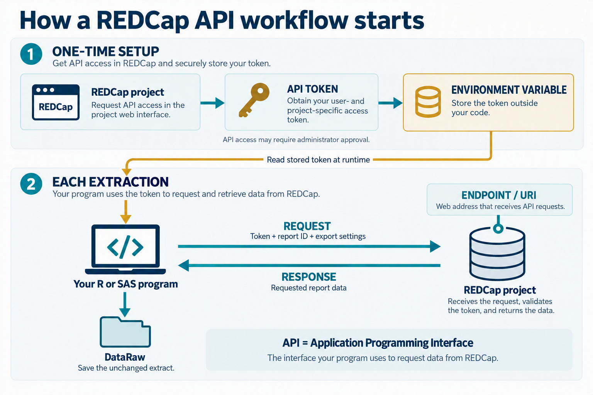

# How a REDCap API workflow starts

# Key terms

::: {.terms-grid}

::: {.term-card}
### API

**Application Programming Interface.** A structured way for one system to request data from another system.
:::

::: {.term-card}
### API token

A unique secret used to authorize access to a particular REDCap project.
:::

::: {.term-card}
### Endpoint / URI

The web address that receives the API request.
:::

::: {.term-card}
### Request

The call sent to REDCap, including the token and requested export settings.
:::

::: {.term-card}
### Response

The data returned by REDCap after the request is processed.
:::

::: {.term-card}
### Environment variable

A value stored outside the program and retrieved when the program runs.
:::

:::