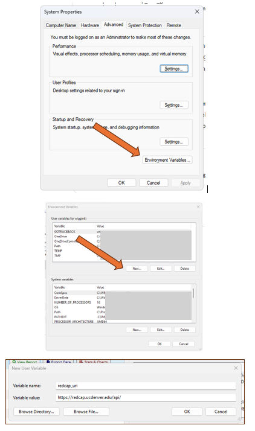

# Store credentials securely

The REDCap URI and API token should be stored outside the R or SAS program and outside the project directory.

::: {.panel-tabset}

## Windows User variables

Create the REDCap URI and project-specific token under **Windows User variables**.

- `redcap_uri` → REDCap API web address
- `token_xxx` → project-specific REDCap token

{fig-alt="Windows User Environment Variables setup"}

::: {.callout-note}
After adding or changing the variables, completely close and reopen R, Positron, RStudio, or SAS before testing them.
:::

### Check that the token is available

**R**

```r
nchar(Sys.getenv("token_xxx"))
```

**SAS**

```sas
%put Token length=%length(%sysget(token_xxx));
```

## Secure file / .Renviron

Store credentials in a protected text file in a secure location outside the project directory and do not track the file with Git.

### R: user-level .Renviron

Open the user-level `.Renviron` file:

```r
usethis::edit_r_environ()
```

Add the REDCap URI and project-specific token:

```text
redcap_uri="https://redcap.ucdenver.edu/api/"
token_xxx="YOUR_PROJECT_TOKEN"
```

::: {.callout-important}
Restart R after adding or changing values in `.Renviron`.
:::

The program can then retrieve the stored values when it runs:

```r
redcap_uri <- Sys.getenv("redcap_uri")
token <- Sys.getenv("token_xxx")
```

### R packages for API calls

- **REDCapR:** [R utilities for interacting with REDCap](https://github.com/OuhscBbmc/REDCapR)
- **qualtRics:** [Introduction to qualtRics](https://docs.ropensci.org/qualtRics/)

:::